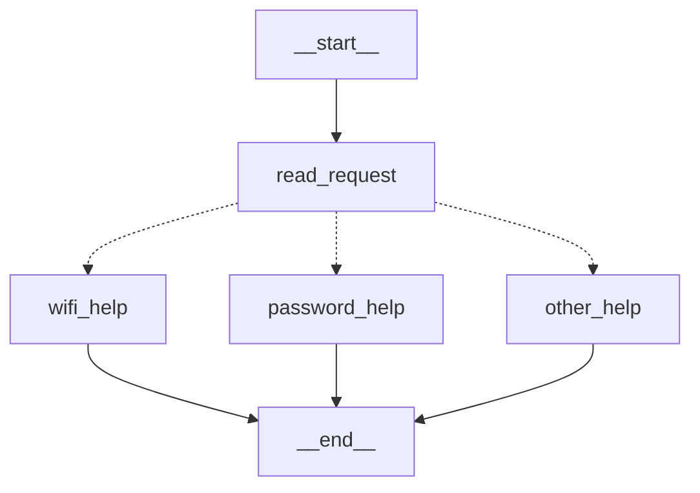
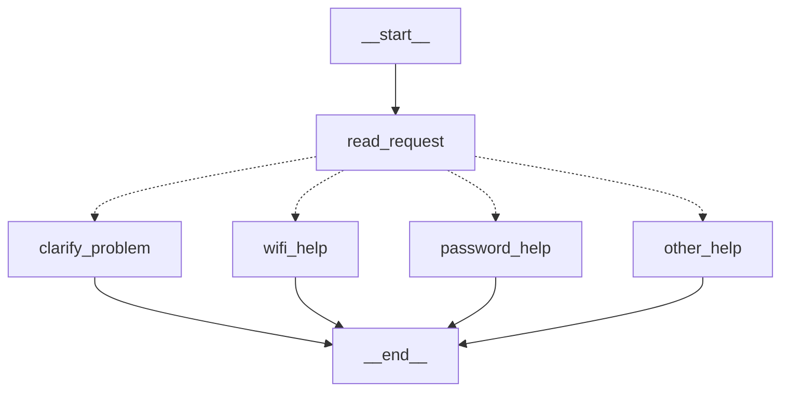
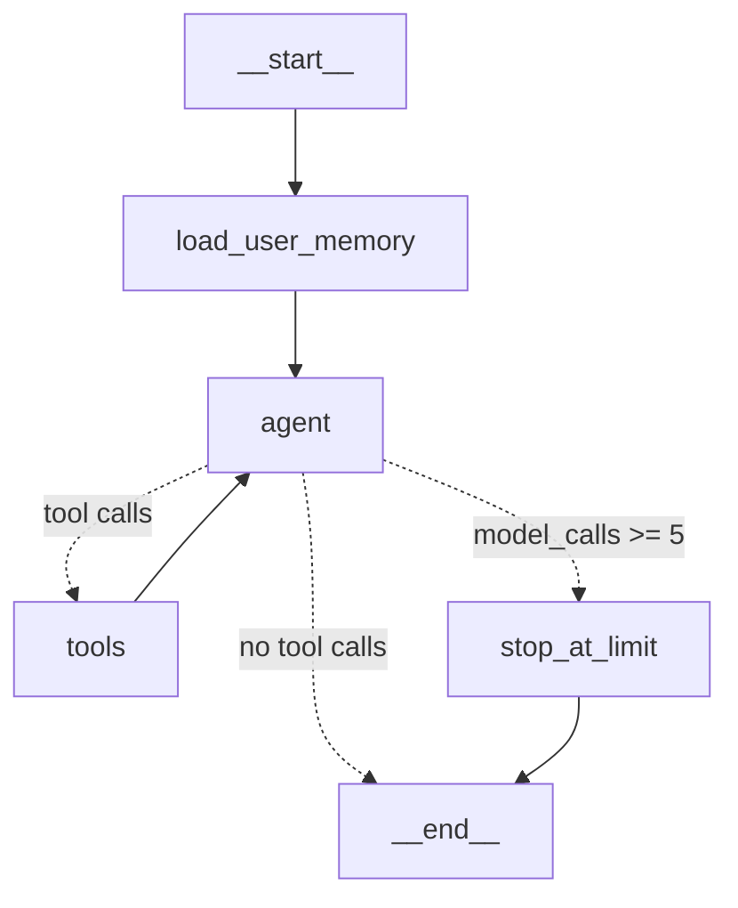

# HW5 — My LangGraph helpdesk

**Student:** Dilyara Kabysheva · **GitHub:** [dilyarakabysheva](https://github.com/dilyarakabysheva) · Narxoz University · CSS-4007 Artificial Intelligence
**Repository:** https://github.com/dilyarakabysheva/css4007-hw5

> **Status of the evidence in this file**
> - Part 1 (S01–S05): real runs of my code. No model is involved. Logs: `outputs/S01.log` … `outputs/S05.log`.
> - Parts 2–3 (S06–S14, P3-D1): so far run only with the **scripted FAKE model** (`helpdesk/fake_model.py`), which is **not an LLM**. Logs: `outputs/fake_model/`. They show that the graph, the tools, the loop limit and memory work, but they do **not** show real model decisions.
> - **TODO before submitting:** put an OpenAI key in `.env` and run `python run_scenarios.py`. This writes the real-model logs to `outputs/S06.log` … `outputs/S14.log`. Then fill the "real model" columns below.

## Part 1 — How the graph works

### My graph and state

```text
START → read_request ──(choose_next_node)──┬─ wifi_help     → END
                                           ├─ password_help → END
                                           └─ other_help    → END
```

Mermaid diagram, simplified from the output of `python part1.py --draw` (dashed arrows are the conditional edge):



State (`Part1State` in `helpdesk/part1_graph.py`):

| Field | Set by | Meaning |
| --- | --- | --- |
| `message` | the caller (input) | the user's original message; no node changes it |
| `category` | `read_request` | `wifi`, `password` or `other` (`both` in the changed graph) |
| `reply` | one help node | instructions from `data/helpdesk.json`, or a question |

| Node | Reads | Changes |
| --- | --- | --- |
| `read_request` | `message` | `category` |
| `wifi_help` | nothing from the state; it reads `helpdesk.json` → `instructions.wifi` | `reply` |
| `password_help` | nothing from the state; it reads `helpdesk.json` → `instructions.password` | `reply` |
| `other_help` | nothing | `reply` (asks: Wi-Fi or password?) |
| `choose_next_node` (conditional edge, not a node) | `category` | nothing; it returns the name of the next node |

**Answers to the four questions**

1. *What does each node read and change?* See the table above. Each node returns only the fields it changes, for example `{"category": "wifi"}`.
2. *Node update vs conditional edge.* A node does work and returns an **update** that LangGraph merges into the state. A conditional edge does not change the state. It is a function that reads the state and returns the **name of the next node**. In my graph `read_request` decides the category, and `choose_next_node` turns that category into a route.
3. *What does the next node receive?* The **whole current state** after the update has been merged. `wifi_help` could still read `message`, which it did not receive from `read_request`'s update. My traces show this: after each node, the state contains all fields so far.
4. *START, END, compile.* `START` is the entry point, so the first node to run is the one connected from `START` (`read_request`). `END` means the run stops and the final state is returned. `compile()` checks the structure (for example, that every edge points to a node that exists) and turns the builder into a runnable object with `invoke` and `stream`.

### Predictions before running

The routing rules: the `wifi` rule is checked first, then `password`, otherwise `other`. Case is ignored.

| Message | Predicted route | Actual route | What I learned |
| --- | --- | --- | --- |
| I cannot connect to Wi-Fi. | read_request → wifi_help | read_request → wifi_help (`outputs/S01.log`) | `wi-fi` matches after lower-casing |
| I forgot my PASSWORD. | read_request → password_help | read_request → password_help (`outputs/S02.log`) | Upper case works because I compare `message.lower()` |
| My laptop screen is broken. | read_request → other_help | read_request → other_help (`outputs/S03.log`) | Unsupported requests get a question back, not a guess |
| My Wi-Fi password does not work. | read_request → wifi_help | read_request → wifi_help (`outputs/S04.log`) | Both topics appear, but the **wifi rule is checked first**, so the password part is ignored |

All four predictions matched the actual runs.

**Both topics:** in S04 the state after `read_request` is `{'message': 'My Wi-Fi password does not work.', 'category': 'wifi'}`. The `if mentions_wifi(...)` branch comes before `elif mentions_password(...)`, so the first matching rule wins. The user may actually have a password problem, but they get Wi-Fi instructions.

### My change to the graph

```text
START → read_request ──┬─ wifi_help       → END
                       ├─ password_help   → END
                       ├─ other_help      → END
                       └─ clarify_problem → END   (new: Wi-Fi AND password)
```



`read_request_with_clarification` now checks "both topics" first and sets `category = "both"`. The conditional edge maps `both` to the new node `clarify_problem`.
New trace (`outputs/S05.log`, command `python part1.py "My Wi-Fi password does not work." --variant with_clarification`):

```text
Route: START -> read_request -> clarify_problem -> END
  1. read_request     update={'category': 'both'}
  2. clarify_problem  update={'reply': 'Your message mentions both Wi-Fi and a password. Is the problem connecting
                              to Wi-Fi, or recovering your account password? Which one should we solve first?'}
```

The difference is a **different path through the graph**: another node runs. The `wifi_help` node itself was not edited.

**What LangGraph controls vs what my functions decide.** LangGraph controls execution. It starts at `START`, runs nodes in edge order, merges each update into the state, calls the conditional edge function, follows the name it returns, and stops at `END`. My Python functions make every decision. `read_request` picks the category with keyword rules, and `choose_next_node` maps it to a node. There is no model in Part 1, so every route can be predicted from the code.

## Part 2 — Model and tools

### The loop

```text
START → load_user_memory → agent ──after_agent──┬─ "tools" → tools ─┐
                             ▲                   │                   │
                             └───────────────────┼───────────────────┘
                                                 ├─ "end"   → END            (no tool calls: final answer)
                                                 └─ "limit" → stop_at_limit → END
```



1. The model (node `agent`) receives the system prompt and the conversation. It returns either a normal answer or an `AIMessage` with `tool_calls`.
2. The conditional edge `after_agent` reads the last message.
3. The node `tools` (my function `run_tools`) runs the real Python functions from `helpdesk/tools.py` and appends one `ToolMessage` per call.
4. Control returns to `agent`, which sees the results and either requests more tools or answers.

**Loop limit.** `load_user_memory` resets `model_calls` to 0 for each new user message, and `agent` adds 1 each time it runs. In `after_agent`, if the model still asks for tools when `model_calls >= MAX_MODEL_CALLS` (5), the graph goes to `stop_at_limit`. That node answers the open tool calls with "not executed" and ends with an explanation. `test_loop_limit_stops_the_graph` checks this with a fake model that never stops asking for tools. LangGraph also has its own `recursion_limit`, but in the installed version (langgraph 1.2.20) the default is very large (10007 steps). So my `MAX_MODEL_CALLS` check is what actually stops the loop, and it gives a friendly message instead of an error.

**Answers**

1. *How does the graph decide between a tool and an answer?* The conditional edge `after_agent` checks whether the model's last message contains `tool_calls`. If it does (and the limit is not reached), the route is `tools`. Otherwise it is `END`.
2. *Who requests and who executes?* The **model** only *requests* a tool by returning a name and arguments in JSON. **My program**, the `tools` node, *executes* it. The model never runs code and never chooses `status_profile`, `user_id` or `thread_id`. My program adds those from the state.
3. *What changes in the state after a tool result?* `messages` gets the `ToolMessage`s. Depending on the tool, `service_checks` (last status per service), `reference_ids` (instruction ids used) and `tickets` (local files created) are updated too. `prepare_ticket` takes its `service_status` from `service_checks`, or uses `"not checked"`, so the model cannot invent a status.
4. *Difference from Part 1?* In Part 1 the route is fixed by my keyword rules and can be predicted. In Part 2 the next step is chosen by the model at run time, based on the message and on earlier tool results. The graph only provides the possible paths and the limit.

### Model and provider

- Real model: **OpenAI** through `langchain-openai` (`ChatOpenAI`, `temperature=0`). The model name comes from `MODEL_NAME` in `.env`.
  **TODO:** write the exact model used for the real run here: `____________`.
- Tests and offline runs: **FAKE MODEL** `fake-helpdesk-model (scripted rules, not an LLM)`. Every reply starts with `[FAKE MODEL]`.

### Direct tool calls (no model, no graph)

These calls are covered by `tests/test_tools.py`:

```python
find_instructions("Wi-Fi")              # -> {"found": True, "instruction_id": "GUIDE-WIFI", "steps": [...]}
check_service_status("wifi", "wifi_outage")            # -> {"status": "outage", ...}
check_service_status("password", "recovery_outage")    # -> service "account_recovery", status "outage"
prepare_ticket("wifi", "Campus-Demo will not connect", ["enabled Wi-Fi"],
               user_id="demo-user-a", thread_id="t1", ticket_dir=...)  # -> writes TKT-....json (draft)
prepare_ticket("wifi", "", [], ...)     # -> {"created": False, "missing": ["problem description", "steps already tried"]}
```

### A run that uses several tools (S06, second message)

From `outputs/fake_model/S06.log`. **This is the FAKE model, not a real LLM.**

```text
2. agent  MODEL REQUESTS TOOLS: check_service_status({"service": "wifi"})
3. tools  TOOL RESULT check_service_status: {"service": "wifi", "status": "operational", ...}
4. agent  MODEL REQUESTS TOOLS: prepare_ticket({"category": "wifi", "summary": "Wi-Fi problem: Campus-Demo still will not connect",
                                                "steps_tried": ["I enabled Wi-Fi", "forgot the saved network"]})
5. tools  TOOL RESULT prepare_ticket: {"created": true, "file": "outputs/fake_model/tickets/TKT-....json", "service_status": "operational", ...}
6. agent  MODEL ANSWER: I prepared a local ticket draft ... Nothing has been sent.
```

The first message of S06 used `find_instructions` (GUIDE-WIFI), so the ticket's `reference_ids` contains `GUIDE-WIFI`.
**TODO:** after the real run, paste the matching part of `outputs/S06.log` here.

### Same request, three snapshots (S06 / S07 / S08)

| Snapshot | `check_service_status` result | Next step chosen | Fake-model log | Real-model log |
| --- | --- | --- | --- | --- |
| `normal` | operational | `prepare_ticket` → local draft | `outputs/fake_model/S06.log` | TODO `outputs/S06.log` |
| `wifi_outage` | outage | no ticket; explains the condition was not met; no repair time | `outputs/fake_model/S07.log` | TODO `outputs/S07.log` |
| `status_unavailable` | unknown | no ticket; asks whether to draft one saying status could not be checked | `outputs/fake_model/S08.log` | TODO `outputs/S08.log` |

The request text is the same, and only the snapshot passed with `--profile` changes. Because the tool result changes, the next step changes too.

## Part 3 — Memory

**Two kinds of memory**

- **Conversation memory** comes from LangGraph's `SqliteSaver` checkpointer (`local-storage/checkpoints.sqlite`). After every node the whole state of the thread is saved: `messages` (all user messages, model answers, tool requests and results), `service_checks`, `reference_ids` and `tickets`. The current problem and the steps already tried are in these saved messages.
- **User memory** is `local-storage/user_memory.json`, saved per `user_id`, for example `{"demo-user-a": {"language": "Kazakh"}}`. The node `load_user_memory` reads it at the start of every turn. If the new message says "I prefer replies in X", the node saves X. The preference is learned from the message. It is not hard-coded and not read from `demo_users.json`.

**`thread_id` vs user identifier.** A `thread_id` identifies **one conversation**, and the checkpointer stores and loads state by it. A `user_id` identifies **a person**, who can have many threads. My checkpointer key is `"{user_id}:{thread_id}"` (`checkpoint_config`), so two users who use the same thread name still get separate conversations. User memory is keyed only by `user_id`, so it is shared across that user's threads and is never visible to another user. The model never chooses which user's data is loaded: `user_id` comes from the command line.

**Retrieval vs memory.** Looking up Wi-Fi instructions is **retrieval**. The answer comes from a fixed reference file (`helpdesk.json`) that is the same for everyone and does not change because of the conversation. Recalling the chosen language is **memory**. It is information the user gave in an earlier conversation, stored for that one user and read back later.

**Memory must survive a restart.** Both stores are files on disk. `run_scenarios.py` runs each part between `restart_process` events as a **new Python process**, and the logs show different pids. `test_memory_survives_a_real_process_restart` runs `chat.py` twice as separate processes.

| Situation | Command used | Log file | What happened |
| --- | --- | --- | --- |
| Refer to an earlier message | `python run_scenarios.py --fake-model --only P3-D1` | `outputs/fake_model/P3-D1.log` (FAKE) | Turn 1 returned GUIDE-WIFI. For "I already tried that", 2 earlier messages were read from the checkpoint, and the answer explains that "that" means the GUIDE-WIFI instructions. |
| Close, restart and resume | `python run_scenarios.py --fake-model --only S11` (process 1, then process 2) | `outputs/fake_model/S11.log` (FAKE) | Process 2 had a different pid and read 2 earlier messages from the checkpoint. The reply named the Wi-Fi problem and the steps "I enabled it; tried reconnecting". |
| Same user, new conversation | `python run_scenarios.py --fake-model --only S12` | `outputs/fake_model/S12.log` (FAKE) | Thread `preference-a2` had 0 earlier messages, but user memory returned `{'language': 'Kazakh'}`. |
| Different user | `python run_scenarios.py --fake-model --only S13` | `outputs/fake_model/S13.log` (FAKE) | For demo-user-b: `read user memory for demo-user-b: nothing saved` and 0 earlier messages. The reply says nothing was recorded. |

**TODO:** repeat these with the real model (`python run_scenarios.py --only P3-D1 S11 S12 S13`). The real model should actually reply in Kazakh. The fake model only notes the preference because it can only write English.

## Part 4 — Running and checking my work

- Setup, run commands and Python version: [README.md](README.md).
- Exact package versions: [requirements.txt](requirements.txt). Python 3.11.1.
- Memory location and reset: README section 5 (`python reset_memory.py`).
- CI: [.github/workflows/tests.yml](.github/workflows/tests.yml) runs `pytest` on every push, with no API key.

| Test file | What it would catch if the code broke |
| --- | --- |
| `test_part1_routing.py` | a wrong rule order, case-sensitive matching, a missing `wi-fi` alias, `clarify_problem` not wired, the original message being overwritten |
| `test_tools.py` | wrong instruction ids, the wrong snapshot or the password→account_recovery mapping broken, tickets missing template fields, tickets created without details or with secrets |
| `test_user_memory.py` | a question about language mistaken for a new preference, preferences mixed between users, a preference not saved to disk |
| `test_agent_and_memory.py` | the tool loop not running tools, a ticket made during an outage or unknown status, the loop never stopping, conversation not restored after reopening storage or after a real process restart, a new thread seeing old messages, one user seeing another user's preference |

Tests that run the graph use the **fake model**, so they test my program and not the intelligence of an LLM. The real-model demonstration is kept separate (`python run_scenarios.py` without `--fake-model`).

## Choices and limitations

- **Storage:** SQLite (`SqliteSaver`) for conversation checkpoints, because it is supplied, needs no server, survives restarts, and is one file. A small JSON file for user preferences, because it is simple and a person can open it and see what is remembered.
- **Preference detection** uses a regular expression (`prefer replies in X`, `reply in X`) with a list of known languages. Unusual wording like "talk to me in Kazakh" would be missed. A model could extract it instead, but then the model would be writing user memory.
- **Tool execution** is my own `run_tools` node instead of LangGraph's prebuilt `ToolNode`. This keeps "who executes the tool" visible and lets my program add `status_profile` and the checked service status.
- **Fake model** follows keyword rules. It is only for tests and offline demos and is not a replacement for the real LLM run.
- **Real LLM:** results depend on the model. A weaker model might call `prepare_ticket` before checking the status. The system prompt states the conditional rules, and the ticket's `service_status` is always filled by my code, never by the model.

## Supplied scenarios — my actual results

Part 1 rows are real runs. Rows for S06–S14 are currently **fake-model runs** (`outputs/fake_model/`), and the real-model logs are still TODO.

| Scenario | Command or manual steps | Log file | What happened / what I changed |
| --- | --- | --- | --- |
| S01 — Simple Wi-Fi route | `python part1.py "I cannot connect to Wi-Fi."` | `outputs/S01.log` | read_request (category=wifi) → wifi_help; GUIDE-WIFI steps |
| S02 — Case-insensitive password route | `python part1.py "I forgot my PASSWORD."` | `outputs/S02.log` | category=password → password_help; works because of `.lower()` |
| S03 — Unsupported request | `python part1.py "My laptop screen is broken."` | `outputs/S03.log` | category=other → other_help asks "Wi-Fi or a password?" |
| S04 — Two topics before the graph change | `python part1.py "My Wi-Fi password does not work." --variant original` | `outputs/S04.log` | category=wifi → wifi_help; the wifi rule is first, so the password part is lost |
| S05 — Two topics after adding clarification | `python part1.py "My Wi-Fi password does not work." --variant with_clarification` | `outputs/S05.log` | category=both → new node clarify_problem asks which problem first |
| S06 — Instructions then local ticket | `python run_scenarios.py --only S06` | fake: `outputs/fake_model/S06.log`; real: TODO | Turn 1: find_instructions → GUIDE-WIFI. Turn 2: check_service_status=operational → prepare_ticket with the user's steps; local file named in the reply |
| S07 — The same request during a Wi-Fi outage | `python run_scenarios.py --only S07` | fake: `outputs/fake_model/S07.log`; real: TODO | status=outage → no ticket; says the condition was not met and there is no repair time |
| S08 — Status source unavailable | `python run_scenarios.py --only S08` | fake: `outputs/fake_model/S08.log`; real: TODO | status=unknown → no ticket; asks whether to draft one explaining the status could not be checked |
| S09 — Missing ticket details | `python run_scenarios.py --only S09` | fake: `outputs/fake_model/S09.log`; real: TODO | Turn 1: asks for the problem and the steps tried (no tool). Turn 2: prepare_ticket with service_status "not checked" |
| S10 — Use the current conversation | `python run_scenarios.py --only S10` | fake: `outputs/fake_model/S10.log`; real: TODO | Turn 2 read 2 earlier messages from the checkpoint and listed the steps already tried |
| S11 — Persist and recall after restart | `python run_scenarios.py --only S11` (2 processes) | fake: `outputs/fake_model/S11.log`; real: TODO | New pid after restart; problem and steps recalled from the SQLite checkpoint |
| S12 — Preference across threads without replay | `python run_scenarios.py --only S12` (2 processes) | fake: `outputs/fake_model/S12.log`; real: TODO | New thread: 0 earlier messages; language Kazakh from user memory |
| S13 — Do not share memory between users | `python run_scenarios.py --only S13` | fake: `outputs/fake_model/S13.log`; real: TODO | demo-user-b: nothing in user memory, 0 earlier messages; reply says nothing recorded |
| S14 — Password recovery outage | `python run_scenarios.py --only S14` | fake: `outputs/fake_model/S14.log`; real: TODO | check_service_status("account_recovery") = outage under recovery_outage; no repair time invented |

What I would change if a behaviour was wrong. If the real model makes a ticket before checking the status (S06/S07), I would make the rule in the system prompt stricter, or add a graph check that blocks `prepare_ticket` while a conditional status check is still missing. If the preference is not detected, I would extend the patterns in `user_memory.py`.
